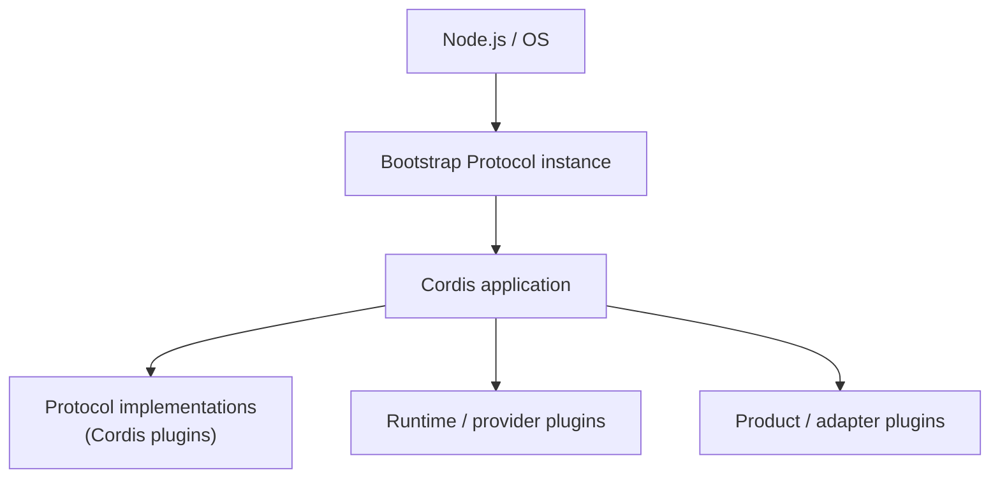
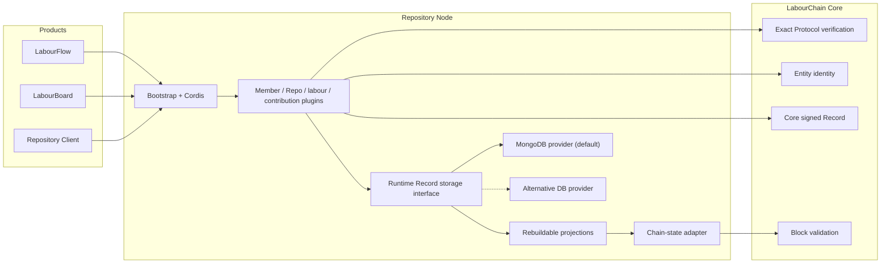
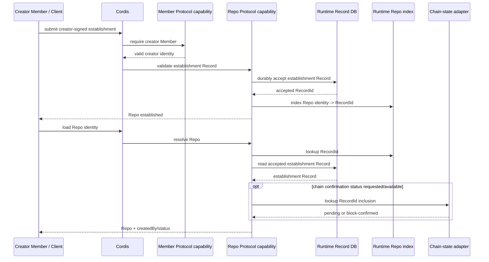

# Repository Architecture

Repository 采用 Cordis 的插件运行模型组织仓库能力。本页描述 Repository 的系统结构、插件边界、运行关系和数据流，是 `docs/requirements.md` 到 `specs/` 之间的 Design / Architecture 层。

当前 Architecture 只固定已经确认的结构原则。具体 Protocol 字段、包名、存储实现和 API 形式在进入 Spec 前不锁定。

## 架构原则

Repository 遵循 Cordis 的“万物皆插件”模型。能够独立装载、替换、声明依赖或管理生命周期的能力，默认以 Cordis plugin 组织。

Repository 不在 Cordis 之外再建立一套 Runner、Hoster、Plugin Manager、Service Container 或生命周期系统。插件发现、依赖、Context、Service、Effect 和生命周期由 Cordis 提供。

LabourChain 在 Cordis plugin 运行模型之上增加的是链上 Protocol 的稳定语义：需要被历史事实长期引用的协议行为以版本化 Protocol 声明，并由 Cordis plugin 作为其 executable implementation。

```text
LabourChain Protocol
└── executable implementation = Cordis plugin

Cordis plugins without chain-stable semantics
└── Runtime / product plugins
    └── 存储、索引、适配、展示等运行能力
```

Protocol 与 Cordis Plugin 描述不同层级：前者是链上稳定语义与身份，后者是唯一运行时插件抽象。不建立第二套插件类型系统。

## Bootstrap

Repository 的可执行运行环境由一个稳定版本的 bootstrap 代码启动。

Bootstrap 的特殊之处只有一点：它具有可以由 Node.js / 操作系统直接启动的入口，并在启动时创建 Cordis application。Cordis 启动后，其余能力仍按普通插件方式装载和运行。

Bootstrap 自身的稳定代码版本使用 Protocol 的格式声明。因此，一个正在运行的节点可以理解为某个 Bootstrap Protocol 版本的实例。



Bootstrap 不因此成为 Cordis 之外的协议管理层。它负责把运行环境启动起来，随后使用 Cordis 本身的插件机制。

Bootstrap 声明其兼容的 Cordis 版本范围，并与所加载插件共享同一个 Cordis runtime。当前不要求 Bootstrap Protocol 固定到某个精确的 Cordis patch 版本，也没有必要再建立独立的 execution-profile 或 runner-version 模型。

## Node

一个 LabourChain Repository node 是某个 Bootstrap Protocol 版本的运行实例，以及该实例加载的 Cordis plugins、providers 和配置。

```text
Repository Node
=
Bootstrap Protocol instance
+ Cordis
+ loaded plugins
+ runtime providers
+ configuration
```

节点具有哪些 Repository 能力，取决于实际加载了哪些插件，而不是一个固定的 Repository mega-service。

## Protocol implementation

LabourChain Protocol 定义链上稳定语义和协议版本；对应 executable implementation 是 Cordis plugin。

协议版本与实现一起演进。已经存在并可能被历史事实引用的协议版本不通过在同一个实现中修改分支语义来升级；新的协议语义使用新的版本实现。

```text
Protocol A v1 -> Cordis plugin implementation
Protocol A v2 -> Cordis plugin implementation
```

同一节点可以按需要同时加载多个协议版本或多个历史 Protocol artifacts。人类可读的 `name@version` 用于表达 Protocol reference，但历史解释和验证的机器权威是事实实际携带的 exact `ProtocolHash`。节点不能仅凭相同版本号、兼容范围或本地最新版本选择 implementation。

历史解析必须以 `ProtocolHash` 精确取得对应 descriptor / executable artifact，使用 Core 提供的验证边界核对 descriptor、artifact 与 hash，并确认其人类可读 Protocol reference 与事实声明一致。缺失 exact hash 时必须失败，不能 fallback 到 `latest`、同版本的另一 artifact 或“看起来兼容”的实现。

Protocol 的具体发现形式和包命名在 Spec 阶段确定。Architecture 不建立第二套插件管理器；验证后的 executable implementation 仍通过 Cordis 被加载。

## 插件边界

Cordis plugins 不按照 CRUD 操作或单个 Requirement 机械拆分。

拆分主要服从协议边界、版本边界和生命周期。一起升级、一起加载、一起失效且没有独立运行价值的紧密协议可以由同一个 Cordis plugin 实现；能够被其他产品独立复用的协议应避免与 Repository 产品运行时绑定。

Member、`labour.record`、Repo、Asset 和 contribution relation 都应首先按各自协议边界提供可组合能力。`labour.record@0.1.0` 是独立 Cordis Protocol implementation；旧 `asset.content@0.1.0` 已延后返工，不作为当前已接受的通用 Asset Contract，不依赖 Board/Project 产品模型。LabourFlow 等上层产品可以只加载所需协议，不应为了使用同 identity 的 Member + labour Record + Asset + Repo 能力而加载完整 Repository 产品运行时.

Contribution history 属于事实的 view / projection。它可以由插件提供查询、索引或缓存能力，但不需要为了概念完整性固定建立一个 History Protocol。

## Core、Record ingress 与链确证边界

Core 提供 Entity、Record、ProtocolHash 与 Block 的身份、签名和确定性验证，不提供固定数据库。Repository 是这些事实的正常提交与本地查询节点，不是链共识或独立验证的信任根。

**目标 Runtime persistence：默认 MongoDB，按 Board 的已验证实践提供可替换的 DB adapter。** Protocol 与 Repository domain services 仅使用窄存储接口；MongoDB collection、BSON `_id`、连接管理和索引由 provider 实现承担。其他 DB 可以实现等价接口，但不得改变 Core RecordId、签名内容或 Protocol 语义。当前 `RecordJournalService`（filesystem）与 `RuntimeRecordDatabaseService`（journal 序列化包装）是**待替换的旧实现**，不能称为已落地 MongoDB Runtime DB。

```text
Core Record / verified Protocol facts
           ↓
Repository domain services (Member / Repo / Contribution)
           ↓
narrow durable Record DB contract
           ↓
MongoDB provider (default) | alternative DB provider
           ↓
provider-managed durable state + indexes
```

数据库负责已确认写入的数据持久性与崩溃恢复；Node 重启只重建 Cordis 运行环境，从 DB 读取持久事实并按必要的 exact Protocol 重新验证与恢复可重建索引。**不再有贡献请求 staging、自动续办 `recoverPending()` 或应用层的独立 Recovery 子系统。**

Repo acceptance 的事实来源仍是有效且持久的 Repo-signed Record `D`。A/L 等已经独立保存的事实不因为 D 缺失而自动构成接受。调用方可以显式重试原 signed request；这依赖持久化提供者的幂等/唯一约束，不能被描述为自动重放未完成业务请求。

DB 的 unique indexes/conditional writes 要求在多进程、多节点访问下成立；此前仅依赖 same-process `runExclusive()` 的方式不是目标一致性保证。MongoDB 跨文档或跨 collection 操作不是天然原子的，若实际领域不变量要求多文档原子性，必须使用实际部署可用的 MongoDB transaction 或另一个明确成立的持久化原语，不复制 Board 的弱 standalone fallback 当作强保证。**不为此创建另一个领域 Recovery 协议。**

```text
Runtime DB persisted Record
    -> Repository-local durable fact (not Block confirmation)

accepted Block / chain-state
    -> chain inclusion and confirmation order

derived index / Snapshot / history view
    -> rebuildable query support (never signed fact authority)
```

具体接口原则见 [Runtime Record Database Spec](../specs/runtime-record-database.md)。Cordis 仍只管理插件与资源生命周期。

## Asset Protocol 与持久化边界

**Asset 当前状态：延后实现／待返工。** 过去按 `asset.content@0.1.0` 定义完整字节对象、content-derived AssetId、16 MiB 上限及独立 filesystem `AssetStorageService` 的方案，是已合并的旧实现，不代表经过确认的 Repository Asset 管理模型。上述约束在新的产品设计中**不作为已接受的架构前提**。

需要先区分劳动形成的 Asset、Asset 的具体内容/数字表示，以及 Repo 对成果的接收、保存、检索和管理行为。相关身份、存储位置、内容范围、元数据与生命周期经过 Requirements → Architecture → Specs 审查后再确定。

已确定的领域关系保留：`labour.record@0.1.0` 的 `references[]` / `assets[]` 表达已确认的生产与成果引用；不因撤回旧 Asset 存储方案而加入 `pid`、`previous` 或通用 relation engine。Repo-signed `repo.contribution` 保留 `labourRecordId`、选中成果的 `assetId`、`operator` 等已确认字段，其与未来 Asset provider 的整合尚待返工。

参见 [Asset Spec](../specs/asset.md) 和 [Asset Storage Spec](../specs/asset-storage.md)，均标记为 **Deferred / Rework required**。本轮仅改文档，不删除或改造现有 Asset 代码。

## Repo Runtime 与链上信任边界

Repository Runtime 是正常节点生成、接收、校验、组织和打包候选事实的执行路径，但它不是 LabourChain 的最终可信执行边界。节点可以使用官方开源 Repository 与 Protocol plugins 形成自洽的候选 Records，也可以使用等价实现；一个恶意或非标准节点甚至可以绕过正常 Repository 流程手工构造候选 Block。链上有效性不能建立在“生产者确实运行了官方 Repo 代码”这一假设上。

Block 被其他节点接受之前，Repository 本地的 pending / candidate state 都可以继续被修订、替换或放弃。这里需要区分两种不同的不变性：

```text
specific signed Record
    -> RecordId / signature 约束这个具体 Record 的内容
    -> 修改其签名覆盖的内容后，原 RecordId / signature 不再证明修改后的值
    -> 若要形成新的有效事实，应重新形成对应的有效 Record

candidate set before Block confirmation
    -> Repo 可以选择、替换、追加或放弃待打包 Records
    -> Runtime DB 只描述节点已持久接收的事实和本地派生状态
    -> 这些状态本身不是 canonical chain truth
```

因此 Repository 的本地 validation 主要服务于正常节点的运行自洽、关系维护和打包准备。它可以尽早拒绝明显非法的事实，但 peer node 不信任生产节点已经执行过这些检查，也不把 Runtime database、snapshot 或本地 plugin 执行结果作为链级证明。

当下一版 Core Block packing 能力实现后，Header 只增加由 Records 自身确定性派生的 `vroot`。Block 不保存第二份 ValidationManifest，也不在 Header 重复列出 Runtime plugin / Protocol composition：

```text
Block.records[]
    -> extract (protocol, protocolHash)
    -> reject same protocol / different hash ambiguity
    -> deduplicate
    -> canonical sort
    -> JCS
    -> DoubleSHA256
    -> Header.vroot

Peer validator
    -> L0: recompute recordsRoot + vroot and verify Block signature
    -> L1: read exact ProtocolHash values from actual Records
    -> resolve / verify exact Protocol implementations and dependencies
    -> independently validate Record semantics and Protocol-defined relations
    -> accept Block only after validation succeeds
```

Peer validation 不依赖生产节点之前使用了什么内存对象、snapshot 或执行路径，而只依赖 Block 实际提交的数据及其绑定的验证语义。当前 LabourChain 不要求像通用智能合约平台那样建立一套加密虚拟机或把所有 Repository 执行过程复制到链上；需要重放的是对应 Protocol 对 Block 内容及关系的确定性验证。

Block 内的 Records 可以按照适用 Protocol 建立一个或多个有逻辑的生产关系结构。劳动与 Asset 的输入/输出关系自然形成 tree / forest，必要时可表现为更一般的依赖图；L1 validation 必须使用 Records 直接引用的 exact Protocol semantics 重建并验证这些关系。Repo creation provenance、decision operator 等非生产因果事实不因此被强行塞入同一棵生产树，也不重新引入 `previous` 链。

当前 Repository MVP 只建立支持未来打包所需的 Runtime 边界，不实现完整 Block packer、`vroot` Core contract、peer validator、节点同步或共识。

## Repository 与其他 LabourChain 组件



Repository 不重新定义 Core 已有的 Protocol、Record、Entity identity、signature 或 Block 语义。Core Record 只是通用签名事实容器；劳动记录由 `labour.record@0.1.0` 把 `labourRecord` 作为 `Record.data` 解释。当前 #9 的 Repo 侧采纳事实由具体的 `repo.contribution@0.1.0` 定义，而不是继续依赖一个未指定的 generic confirmation / relation Protocol。未来其他领域事实仍由各自具体 Protocol 定义。

Member 与 Repo 都是同一类组合原则：先有 Core Entity identity，再通过协议获得领域语义。一个 Entity identity/keypair 可以同时满足 Member 与 Repo 协议；这种组合不产生第二个 identity。Repo establishment 只保留创建事实与创建来源，不定义 Repo ownership，也不自动扩展为 Asset 或劳动成果的私人财产权。

LabourFlow 可以在同 identity Member + Repo 协议组合之上提供面向个人的产品体验，但它不需要创建一个嵌套 `PersonalRepo` entity，也不改变底层 Repo 协议。

## Repo establishment 与操作留痕

Repo 是以 Core `EntityPublicKey` 为身份锚点的协议组合，不继承或扩展 Core `Entity` 对象。

Repo establishment 的创建者必须是一个已经满足 Member 协议的 Entity identity。集体 Repo 可以创建另一个独立的 Repo Entity identity；Member-scoped Repo 也允许创建者与 Repo 使用同一个 identity/keypair。

MVP 的 Repo establishment 使用一个由创建者个人签名的 Record 表达最小事实：

```text
Record.createdBy
= creator Member EntityPublicKey

Record.signature
= creator personal signature

Record.data.publicKey
= created Repo EntityPublicKey
```

这与 Core Entity fact 的责任分离保持一致：`Record.createdBy / signature` 表示谁确认了创建事实，`Record.data.publicKey` 表示这条事实声明的 Repo identity。创建关系只用于 provenance，不解释为 ownership、永久控制权、membership 或治理授权。Core `Entity.introducedBy` 同样不用于推导这些政治/组织语义。

Repo 后续采取需要链上留痕的决定时，决定 Record 由 Repo identity 的 private key 签名，并在该 Protocol 的签名 payload / data 中标注实际 `operator: EntityPublicKey`。operator 是单次行为的责任留痕，不是持久角色、membership、ACL 或组织授权证明。谁可以操作 Repo key、如何授权、复核或进行多人治理属于后续组织治理层。

劳动者与 Repo 不建立额外链上 membership。产品可以从 accepted contributions 派生 contributor/member 视图，也可以在本地软件中维护人员分组、标签和筛选条件；这些运行数据不参与链级 validity。

一个 establishment Record 可以处于两个不同的确认层级：

```text
accepted/pending-chain
    -> 已经由配置的 Runtime DB 持久接收
    -> Repository 可以恢复并加载该 Repo

block-confirmed
    -> establishment Record 已被有效 Block 收录
    -> 获得链确证状态
```

建立与重新加载的数据流为：



Runtime Repo index 只是加速 lookup 的可替换数据。Repo identity 来自 establishment Record 的 `data.publicKey`，创建来源来自该 Record 的 `createdBy`。缺失或陈旧的 index 不能创造第二条创建事实；index 可由 Runtime DB 内已持久化的 establishment Records 重建；链状态只决定单独的 Block-confirmation 显示。

## Contribution 数据流

Member 在 Repository 外产生并签署 `labour.record@0.1.0`；Repo 已签署的 `repo.contribution@0.1.0` 是另一个独立 Record。已经确认的字段与关系保持不变：

```text
Member-signed labour Record L
    -> L.data.references[] / L.data.assets[]

Repo-signed acceptance Record D
    -> D.createdBy = Repo EntityPublicKey
    -> D.data = { labourRecordId: L.id, assetId, operator }
```

`D.data.assetId` 在原关系契约下明确选中 `L.data.assets[]` 中的一项成果；不因为一条 Repo 采纳事实而推断该劳动的所有成果都被采纳。具体 Asset identity、provider、数据尺寸、管理及可用性要求**已延后，待 #8 返工**，不能使用旧 filesystem Asset 服务来反向固定领域含义。

目标 Runtime 数据流只确立经过讨论的提交事实与数据库边界：

```text
signed L / signed D + selected result reference
    -> exact Protocol validation + relation validation
    -> MongoDB-backed replaceable Record DB interface
    -> durable L and durable Repo acceptance D (D published last)
    -> Repository COMMITTED
```

本地 DB 的持久接收和独立链的 Block-confirmation 属于两层不同语义。具体多文档写入的原子性、同键唯一约束、以及 Asset 集成，需要在 DB adapter 和 #8 返工中分别验证。现有 `RepositoryContributionService`、文件 journal 和 Asset provider 可作为迁移起点，但并非全部已被新的架构验收。

旧的 `ContributionStagingService` / `RepositoryContributionRecoveryService` 不再属于目标数据流；没有 automatic replay、pre-D staging 状态或第二条 commit 路径。

## Contribution 状态

Repository 接受与链收录是不同的事实，不借助 Node 会话级阶段机确认。

```text
D 未持久存在
    -> 当前没有可用 Repo acceptance fact
    -> 即使其他 Record 或成果已保存在 DB，也不自动成为 COMMITTED

有效 D 已经持久存在
    + 必需依赖事实经验证可读取
    -> Repository COMMITTED

Block 尚无被接受的收录证据
    -> pending-chain

accepted-Block/chain-state 确认相关事实收录
    -> block-confirmed
```

已确认的 `repo.contribution@0.1.0` 字段、签名来源和同键冲突语义继续成立。DB 的已持久化 D 是 Repo 接受事实的依据；DB 数据损坏或必要关系无法验证时，要报告 integrity/storage 错误，不能把该 D 当作健康提交，也不能将其悄悄抹除或从提交请求修复。

没有 `STAGED -> DOMAIN_CONFIRMED -> COMMITTED` 的持久业务状态机。前两种原流程阶段仅属于一次函数执行中的验证步骤，不是数据库事实，不需要重启恢复处理器。

Node 重启时直接读取已持久化的 D/L 等事实，不再按之前保存的请求复跑 `commit()`。显式调用方重试仍应符合幂等与同键冲突规则。本地 candidate Block 的产生或广播不会升级 `pending-chain`。

## 数据与投影

Repository 的目标持久化边界是配置的 Runtime DB（MongoDB 为默认 provider），而不是 filesystem journal + 额外 staging + 状态恢复器。

```text
1. Runtime DB / durable Core Records
   - 持久存储已经接收的 exact signed Records
   - RecordId 与签名字段属于 Core，不属于 MongoDB
   - Repo acceptance D 是 Repository 的接受事实标志，不是 Block-confirmed

2. provider-managed indexes / concrete uniqueness
   - 支持领域所需的查询与唯一约束
   - 数据库原子性必须在真实 provider 上成立
   - MongoDB _id / collections 不进入 Protocol identity

3. derived projections / Snapshots
   - 基于 DB 持久事实和 exact Protocol 语义恢复
   - 支持历史查询和索引加速
   - 不成为事实来源

4. chain-state adapter
   - 查询已被接受 Block 的真实收录证据
   - 不由本地 DB 推断 Block 确认
```

已撤回的独立 Contribution Recovery / staging 数据类别**不再存在于目标架构**。数据库自身恢复已提交的数据；Node 只重新连接 DB 并读取数据。显式 API 重试不是后台恢复任务。

Asset 的管理与存储模型尚待重新审查，因此不在本节继续规定 exact Asset descriptor/bytes、Repo Asset registry 结构或任何 filesystem 写入协议。Repo Asset / Contributor 浏览可以在后续查询设计中讨论，但不能从旧代码反推领域契约。

Repo creation provenance、labour Record、Repo acceptance 仍是签名事实；`Patch` / `Snapshot` 的链上/运行时区别保持不变。Repository 不创建第二套链，也不拥有全链 `repo.records[]` 事实集合。

## Cordis 生命周期

插件资源、依赖和运行时副作用服从 Cordis 生命周期。

Repository Architecture 不另行定义插件 activate / deactivate、依赖注入或 HMR 体系。插件需要的外部资源通过 Cordis 生命周期获取和释放，避免重复激活造成资源泄漏或全局状态污染。

## MVP 边界

Architecture 当前不锁定：

- 具体 npm package 名称和 monorepo 目录；
- Protocol metadata 最终字段；
- `member.profile` 的完整字段、更新和隐私模型；
- durable Record journal 的最终 package/service/API 形式；
- chain-state adapter 的最终 package/service/API 形式；
- MongoDB 默认 provider 之外的可替换 DB 具体实现；
- HTTP / REST / WebSocket 接口；
- UI；
- 高级 ACL 和角色体系；
- 所有权、私人财产和收益分配协议；
- 搜索引擎；
- Project / Board 业务；
- Block packing 内部实现；
- 节点同步；
- 私有证明、收益分配和结算机制。

这些内容只有在 Requirement 明确进入范围后，或现有 Requirement 的实现确实需要稳定的结构边界时，才继续投影到 Design、Spec 和实现。
